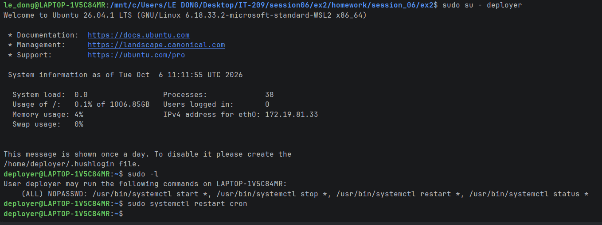

# Bài 2: Cấu hình phân quyền Nhóm và sudoers bằng visudo

## 1. Mục tiêu

Cho nhóm `devops-admin` (có user `deployer`) quyền `start/stop/restart/status` dịch vụ qua `systemctl` **không cần mật khẩu**, nhưng **không** cấp toàn quyền root.

## 2. Nhật ký lệnh đã thực hiện

```bash
systemctl enable --now cron
groupadd devops-admin
adduser --disabled-password --gecos "" deployer
usermod -aG devops-admin deployer
sudo cp -p /etc/sudoers /etc/sudoers.bak.ex2     # sao lưu
sudo visudo -cf <file-tam>                       # kiem tra cu phap truoc khi ap dung
sudo install -m 0440 -o root -g root <file-tam> /etc/sudoers
sudo visudo -c
```

## 3. Dòng cấu hình đã thêm vào /etc/sudoers

```
60:%devops-admin ALL=(ALL) NOPASSWD: /usr/bin/systemctl start *, /usr/bin/systemctl stop *, /usr/bin/systemctl restart *, /usr/bin/systemctl status *
```

Giải thích: `%devops-admin` (dấu `%` = nhóm) `ALL=(ALL)` (mọi host, chạy với tư cách mọi user) `NOPASSWD:` (không hỏi mật khẩu) chỉ với các lệnh `systemctl start|stop|restart|status` có đường dẫn đầy đủ.

Quy tắc được kiểm tra bằng `visudo -c` trước khi áp dụng, tránh viết sai cú pháp làm mất quyền sudo của toàn hệ thống.

## 4. Kết quả kiểm tra

Thông tin user:
```
$ id deployer
uid=1002(deployer) gid=1002(deployer) groups=1002(deployer),100(users),1001(devops-admin)
```

Kết quả `sudo -l` khi đăng nhập bằng `deployer`:
```
$ sudo -l
User deployer may run the following commands on LAPTOP-1V5C84MR:
    (ALL) NOPASSWD: /usr/bin/systemctl start *, /usr/bin/systemctl stop *, /usr/bin/systemctl restart *, /usr/bin/systemctl status *
```

Restart dịch vụ cron (không hỏi mật khẩu; dùng `sudo -n` để chứng minh không có prompt):
```
$ sudo systemctl restart cron
-> restart cron THANH CONG, khong hoi mat khau
```

Trạng thái cron:
```
$ sudo systemctl status cron
● cron.service - Regular background program processing daemon
     Loaded: loaded (/usr/lib/systemd/system/cron.service; enabled; preset: enabled)
     Active: active (running) since Tue 2026-10-06 11:11:17 UTC; 18ms ago
 Invocation: 21aedebadeca48e59f7a22fd14ef6727
       Docs: man:cron(8)
```

Kiểm tra nguyên tắc đặc quyền tối thiểu: `deployer` **không** được chạy lệnh khác:
```
$ sudo cat /etc/shadow
sudo: I'm sorry deployer. I'm afraid I can't do that
```

**Kết luận:** ĐẠT

## 5. Lưu ý bảo mật

- Ký tự `*` trong sudoers khớp mọi tham số, nên `systemctl restart *` cũng khớp cả cú pháp có thêm tùy chọn. Môi trường thật nên liệt kê rõ dịch vụ cần cấp (ví dụ `systemctl restart nginx`).
- Luôn sửa sudoers bằng `visudo` (hoặc kiểm tra bằng `visudo -cf`) để tránh lỗi cú pháp khóa mất sudo.

## 6. Ảnh chụp màn hình khi đăng nhập bằng user deployer

Lệnh thực hiện: `sudo su - deployer`, sau đó `sudo -l` và `sudo systemctl restart cron`.

